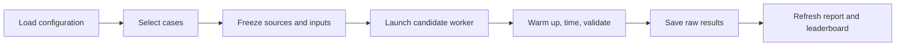

# Harness workflow

The controller uses Python and PyYAML. GPU frameworks load only inside workers.

| Module | Responsibility |
| --- | --- |
| [config.py](config.py) | Expand environment variables, validate YAML, resolve paths and expand case grids. |
| [runner.py](runner.py) | Select cases, create runs, freeze inputs and launch candidates serially. |
| [runtime.py](runtime.py) | Select GPU/CPU resources, build local/Docker commands and stop timed-out workers. |
| [worker.py](worker.py) | Load one adapter, warm up, time completed outputs and validate every repeat. |
| [workload.py](workload.py), [validation.py](validation.py) | Build scenario inputs and check beam outputs against the shared contract. |
| [artifacts.py](artifacts.py) | Read/write JSON and hash model, source, suite and input identities. |
| [reporting](reporting) | Derive measurements and render saved results. No GPU work. |
| [profiling](profiling) | Capture and summarize measured NVTX ranges with Nsight. |

## Configuration

| Directory | Defines |
| --- | --- |
| [../config/runs](../config/runs) | Selected scenarios, candidates, baseline, hardware and execution policy. |
| [../config/scenarios](../config/scenarios) | Model, inputs, case grid, generation rules and measurement protocol. |
| [../config/solutions](../config/solutions) | Adapter, source, runtime, environment and engine options. |
| [../config/hardware](../config/hardware) | Required GPU SKU and optional compute ceiling. |

`plan` and `e2e` default to `config/runs/default.yml`, with SGLang as the baseline.
`--config config/runs/readme.yml` selects the pinned SGLang beam-search branch.
Model, input, source and mount paths are relative to the suite root; `output_dir`
is relative to the run YAML. Both supplied runs write to the suite's `results/`.
Resolved `${VARIABLE:-default}` values are saved with the run configuration.

## Commands through the harness

| Command | Path |
| --- | --- |
| `plan` | Load → select → print cases. |
| `e2e` | Load → select → verify hardware → freeze → launch → save → report. |
| `report` | Read saved JSON → rebuild run/diagnosis reports and leaderboards. |
| `diagnose` | Verify saved identities → replay one case under Nsight → save trace and kernel tables. |

## Worker settings

| Setting | Local worker | Docker worker |
| --- | --- | --- |
| `runtime.kind` | `local`: Python subprocess | `docker`: container |
| `runtime.python` | Executable on the host | Executable inside the image |
| Candidate `env` | Added to subprocess environment | Passed as `docker run --env KEY=VALUE` |
| `runtime.mounts` | Paths already exist on host | Read-only mounts at identical paths |
| GPU UUID | `CUDA_VISIBLE_DEVICES` | `--gpus device=UUID` and `CUDA_VISIBLE_DEVICES` |
| CPU affinity | Inherited | `--cpuset-cpus` matches controller |

Example: export `GR_DECODE_ATTEN_ROOT` before loading the SID-GR YAML.
`config.py` expands it into the candidate's `env` and `runtime.mounts`.
`runner.py` saves those values in `request.json`; `runtime.py` forwards them.

## Run artifacts

| Path | Role |
| --- | --- |
| `manifest.json` | Frozen definitions, checkpoint identity, hardware and run status. |
| `workloads/*.json` | Exact token inputs shared by candidates. |
| `jobs/<candidate>/<scenario>/<case>/request.json` | Frozen worker inputs, source identity and settings. |
| `command.json`, `worker.log` | Actual launch command and worker output. |
| `result.json` | Status, raw samples, every measured beam output and environment. |
| `summary.json`, `report.md` | Derived metrics and readable run report. |
| `diagnostics/<capture>/` | Profiled results, kernel tables and native traces. |
| `cache/` | Compilation caches; excluded from published archives. |
| `../leaderboards/<scenario>.md` | Latest non-smoke status per case/candidate. |

Every invocation gets a new run directory. Every finished job refreshes the report.
Failed and unsupported jobs remain visible. Timeouts stop the worker process group
and its container. Archived examples pack these files into one tarball.

## Add a candidate

Keep workload definitions in `config/scenarios/`, shared input/output handling in
`harness/workload.py` and `harness/validation.py`, and framework APIs in `entrypoints/`.
Implement `check_support(case, solution)` and an `Adapter(request)` with:

| Method | Contract |
| --- | --- |
| `generate(workload)` | Return CPU rows: `request_id`, `beams: [{token_ids, score}]`. |
| `synchronize()` | Wait for this candidate's GPU work. |
| `close()` | Release engine resources. |
| `provenance()` | Record engine options and source/dependency identities. |
| `profile_start()`, `profile_stop()` | Optional profiler control for GPU subprocesses. |

Add `config/solutions/<name>.yml`, select it in a run configuration, then run the CPU tests
and a GPU smoke case. Unsupported semantics must fail explicitly.
